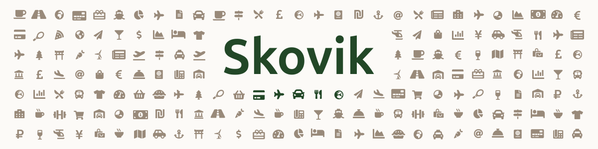

<picture>
  <source media="(prefers-color-scheme: dark)" srcset="./assets/banner-dark.svg">
  <source media="(prefers-color-scheme: light)" srcset="./assets/banner-light.svg">
  
</picture>

### About Skovik

Skovik is expense management for mid-size companies and enterprises that span countries, entities and tax regimes. Employees report expenses, mileage and per diems in seconds. Skovik applies company policy and local tax rules, routes approvals, reconciles corporate cards and posts the result to the finance and HR systems our customers already run.

We're based in Stockholm and Frankfurt, serving customers in more than 70 countries.

### Build with Skovik

- [Developer portal](https://developer.skovik.com) — API reference, authentication and webhooks
- [Documentation](https://docs.skovik.com) — Product and admin guides
- [System status](https://status.skovik.com) — Uptime and incident history

We integrate with platforms such as NetSuite, SAP, Workday, Microsoft Dynamics 365 and many more. If you're building an integration and want to partner with us, [get in touch](https://skovik.com/contact/).

### Work with us

We aim for software that's advanced enough to be indistinguishable from magic. Machine learning, clever algorithms and simple interfaces turn expense reporting from a chore into a few taps, saving employees tens of thousands of hours every month.

There's still a lot to build, and we're looking for people who like technology and complex systems, but also have the ability to make complex things simple for our customers.

Our main office is in Stockholm and we have a second office in Germany. [See open positions](https://skovik.com/about/careers/) or send us an open application.

### Security

If you believe you've found a security issue, please report it  through our contact channels. See [our security docs](https://skovik.com/resources/security/) for more on how we protect customer data.